<picture>
  <source media="(prefers-color-scheme: dark)" srcset="assets/hero-dark.svg">
  <source media="(prefers-color-scheme: light)" srcset="assets/hero-light.svg">
  
</picture>

 

<a href="https://github.com/Santhosh-zeta"><b>GitHub</b></a> &nbsp;·&nbsp;
<a href="https://www.linkedin.com/in/santhosh---v/"><b>LinkedIn</b></a> &nbsp;·&nbsp;
<a href="mailto:iamsanthosh2425@gmail.com"><b>Email</b></a>

 

<picture>
  <source media="(prefers-color-scheme: dark)" srcset="assets/section-about-dark.svg">
  <source media="(prefers-color-scheme: light)" srcset="assets/section-about-light.svg">
  
</picture>

<picture>
  <source media="(prefers-color-scheme: dark)" srcset="assets/about-dark.svg">
  <source media="(prefers-color-scheme: light)" srcset="assets/about-light.svg">
  
</picture>

 

<picture>
  <source media="(prefers-color-scheme: dark)" srcset="assets/section-stack-dark.svg">
  <source media="(prefers-color-scheme: light)" srcset="assets/section-stack-light.svg">
  
</picture>

<picture>
  <source media="(prefers-color-scheme: dark)" srcset="assets/stack-dark.svg">
  <source media="(prefers-color-scheme: light)" srcset="assets/stack-light.svg">
  
</picture>

 

<picture>
  <source media="(prefers-color-scheme: dark)" srcset="assets/section-activity-dark.svg">
  <source media="(prefers-color-scheme: light)" srcset="assets/section-activity-light.svg">
  
</picture>

<picture>
  <source media="(prefers-color-scheme: dark)" srcset="https://raw.githubusercontent.com/Santhosh-zeta/Santhosh-zeta/output/activity-dark.svg">
  <source media="(prefers-color-scheme: light)" srcset="https://raw.githubusercontent.com/Santhosh-zeta/Santhosh-zeta/output/activity-light.svg">
  
</picture>

 

<picture>
  <source media="(prefers-color-scheme: dark)" srcset="https://raw.githubusercontent.com/Santhosh-zeta/Santhosh-zeta/output/stats-dark.svg">
  <source media="(prefers-color-scheme: light)" srcset="https://raw.githubusercontent.com/Santhosh-zeta/Santhosh-zeta/output/stats-light.svg">
  
</picture>

 

<picture>
  <source media="(prefers-color-scheme: dark)" srcset="assets/section-work-dark.svg">
  <source media="(prefers-color-scheme: light)" srcset="assets/section-work-light.svg">
  
</picture>

<!-- work:start -->
<table>
<tr><td width="50%"><a href="https://github.com/Santhosh-zeta/ColdGuard">
<picture>
  <source media="(prefers-color-scheme: dark)" srcset="https://raw.githubusercontent.com/Santhosh-zeta/Santhosh-zeta/output/project-1-dark.svg">
  <source media="(prefers-color-scheme: light)" srcset="https://raw.githubusercontent.com/Santhosh-zeta/Santhosh-zeta/output/project-1-light.svg">
  
</picture>
</a></td><td width="50%"><a href="https://github.com/Santhosh-zeta/MAVIRA">
<picture>
  <source media="(prefers-color-scheme: dark)" srcset="https://raw.githubusercontent.com/Santhosh-zeta/Santhosh-zeta/output/project-2-dark.svg">
  <source media="(prefers-color-scheme: light)" srcset="https://raw.githubusercontent.com/Santhosh-zeta/Santhosh-zeta/output/project-2-light.svg">
  
</picture>
</a></td></tr>
<tr><td width="50%"><a href="https://github.com/Santhosh-zeta/Clinical-Database-Intelligence">
<picture>
  <source media="(prefers-color-scheme: dark)" srcset="https://raw.githubusercontent.com/Santhosh-zeta/Santhosh-zeta/output/project-3-dark.svg">
  <source media="(prefers-color-scheme: light)" srcset="https://raw.githubusercontent.com/Santhosh-zeta/Santhosh-zeta/output/project-3-light.svg">
  
</picture>
</a></td><td width="50%"><a href="https://github.com/Santhosh-zeta/Dropwing_Groups-Public_Website">
<picture>
  <source media="(prefers-color-scheme: dark)" srcset="https://raw.githubusercontent.com/Santhosh-zeta/Santhosh-zeta/output/project-4-dark.svg">
  <source media="(prefers-color-scheme: light)" srcset="https://raw.githubusercontent.com/Santhosh-zeta/Santhosh-zeta/output/project-4-light.svg">
  
</picture>
</a></td></tr>
</table>
<!-- work:end -->

 

<picture>
  <source media="(prefers-color-scheme: dark)" srcset="assets/section-contact-dark.svg">
  <source media="(prefers-color-scheme: light)" srcset="assets/section-contact-light.svg">
  
</picture>

<picture>
  <source media="(prefers-color-scheme: dark)" srcset="assets/connect-dark.svg">
  <source media="(prefers-color-scheme: light)" srcset="assets/connect-light.svg">
  
</picture>

 

<a href="mailto:iamsanthosh2425@gmail.com">iamsanthosh2425@gmail.com</a> &nbsp;·&nbsp; <a href="https://www.linkedin.com/in/santhosh---v/">LinkedIn</a> &nbsp;·&nbsp; <a href="https://github.com/Santhosh-zeta">GitHub</a>

Cards are generated from <a href="profile.toml"><code>profile.toml</code></a> by <a href="scripts/generate.py"><code>scripts/</code></a> — plain Python, no dependencies. Live cards rebuild nightly.

